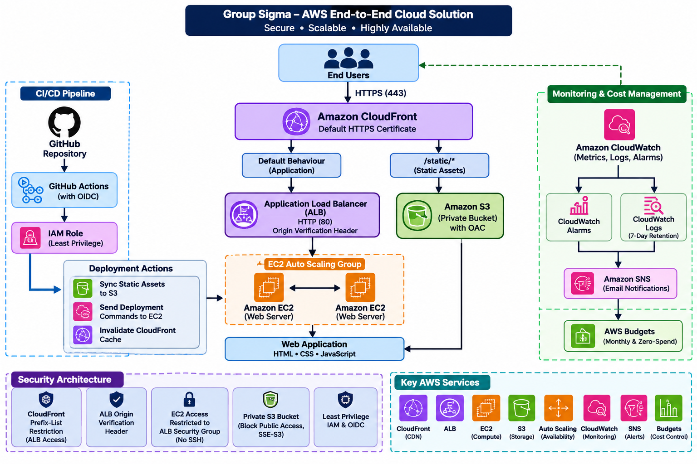

# Group Sigma – AWS End-to-End Cloud Solution
 
## 1. Project Overview
 
Group Sigma's AWS End-to-End Cloud Solution is a cloud-hosted web application designed and implemented using Amazon Web Services (AWS).
 
The project demonstrates how AWS services can work together to provide a secure, scalable, highly available, and monitored web application infrastructure.
 
The solution uses Amazon CloudFront for content delivery, an Application Load Balancer (ALB) to distribute application requests, an EC2 Auto Scaling group to provide application compute capacity, and Amazon S3 to store static assets.
 
GitHub Actions provides automated testing and deployment using OpenID Connect (OIDC), while AWS Systems Manager enables deployment commands to be executed on EC2 instances without requiring SSH access or storing long-lived AWS credentials in GitHub.
 
CloudWatch, Amazon SNS, and AWS Budgets provide monitoring, notifications, and cost-management capabilities.
 
### Project objectives
 
- Design and implement an end-to-end AWS cloud architecture.
- Host and deliver a web application through Amazon CloudFront.
- Distribute application traffic through an Application Load Balancer.
- Use EC2 Auto Scaling to maintain application capacity and improve availability.
- Store static website assets in a private S3 bucket.
- Secure access between infrastructure components using security groups and CloudFront origin controls.
- Enforce HTTPS for end-user access.
- Automate application testing and deployment using GitHub Actions and AWS OIDC.
- Use Systems Manager to deploy application updates to EC2 instances.
- Monitor infrastructure performance and application health using CloudWatch.
- Send monitoring notifications through Amazon SNS.
- Manage and monitor AWS expenditure using AWS Budgets.
- Demonstrate collaborative development using GitHub branches, pull requests, code reviews, and Trello evidence.
 
## 2. Live Application
 
The application is accessible through the Amazon CloudFront distribution:
 
**Live application:** https://d94v8pn8slf9f.cloudfront.net
 
CloudFront provides the public entry point to the application and delivers the website over HTTPS.
 
The application uses two origins:
 
- An Application Load Balancer origin for the main application.
- A private Amazon S3 origin for static assets.
 
The S3 origin is accessed through CloudFront Origin Access Control (OAC), preventing direct public access to the bucket.
 
## 3. Architecture Diagram
 
The architecture follows this request and deployment flow.
 
### Application traffic flow
 
```text
                     END USERS
                         |
                         |
                    HTTPS :443
                         |
                         v
                AMAZON CLOUDFRONT
                  Default HTTPS
                  Certificate
                         |
              +----------+----------+
              |                     |
              |                     |
        Default behaviour     /static/*
              |                     |
              v                     v
       APPLICATION LOAD       PRIVATE AMAZON S3
        BALANCER (ALB)          ORIGIN (OAC)
              |                     |
        HTTP :80              Static assets
        Origin header          CSS / JavaScript
        verification
              |
              v
       EC2 AUTO SCALING GROUP
              |
         +----+----+
         |         |
         v         v
       EC2 1     EC2 2
         |         |
         +----+----+
              |
         Web application
```
 
### Supporting services
 
```text
GITHUB REPOSITORY
        |
        v
   GITHUB ACTIONS
        |
        | OIDC authentication
        v
   AWS IAM DEPLOYMENT ROLE
        |
        +--------------------+
        |                    |
        v                    v
       S3                 SYSTEMS MANAGER
   Static asset sync      Send deployment
                          commands to EC2
        |
        v
   CLOUDFRONT
   Cache invalidation
 
 
MONITORING AND COST MANAGEMENT
 
EC2 / ALB / APPLICATION
          |
          v
     CLOUDWATCH
      |       |
      |       +------> CloudWatch Logs
      |
      v
   CloudWatch Alarms
          |
          v
       AMAZON SNS
          |
          v
     Email alerts
 
AWS COSTS
    |
    v
AWS BUDGETS
    |
    v
Budget notifications
```

 
**Diagram note:** The diagrams above describe the intended traffic and deployment flow. 
 

 
## 4. AWS Services and Their Purpose
 
The project uses the following AWS services.
 
| AWS service | Purpose in the project |
|---|---|
| Amazon CloudFront | Provides the public entry point, HTTPS delivery, caching, and routing to the application and S3 origins. |
| Application Load Balancer | Receives application requests from CloudFront and forwards them to healthy EC2 targets. |
| Amazon EC2 | Runs the web application on the application servers. |
| EC2 Auto Scaling | Maintains the desired number of application instances and replaces unhealthy or terminated instances. |
| Amazon S3 | Stores static website assets such as CSS and JavaScript files. |
| CloudFront Origin Access Control | Allows CloudFront to access the private S3 origin without making the bucket public. |
| AWS IAM | Controls permissions for administrators, users, services, and deployment automation. |
| AWS Systems Manager | Executes deployment commands on EC2 instances without requiring direct SSH access. |
| GitHub Actions | Runs automated validation and deployment when changes are merged into the main branch. |
| IAM OIDC Identity Provider | Allows GitHub Actions to obtain temporary AWS credentials by assuming an authorized IAM role. |
| Amazon CloudWatch | Collects metrics, logs, and alarm information for infrastructure monitoring. |
| Amazon SNS | Sends email notifications when configured CloudWatch alarms enter alarm state. |
| AWS Budgets | Monitors project expenditure and sends budget notifications. |
 
## 5. Application Description
 
The project includes a web application hosted on the AWS infrastructure.
 
The application is developed using:
 
- HTML for page structure.
- CSS for presentation and responsive styling.
- JavaScript for client-side functionality.
 
The application is served through the EC2 web servers behind the Application Load Balancer.
 
Static assets are stored in Amazon S3 and delivered through CloudFront.
 
The application is maintained in the GitHub repository, and approved changes merged into `main` trigger the deployment workflow.
 
### Application components
 
- Main HTML application page.
- CSS stylesheet.
- JavaScript functionality.
- Health-check endpoint used by the load balancer.
- Instance identification endpoint used to verify requests served by different instances.
- Version information endpoint used to verify deployed application revisions.
 
The application source and supporting files are maintained in the repository.
 
## 6. Network Ports and Security Group Rules
 
The architecture restricts access between components to the traffic required for the application to operate.
 
### Application traffic ports
 
| Source | Destination | Protocol / port | Purpose |
|---|---|---|---|
| End users | CloudFront | HTTPS / TCP 443 | Secure public application access. |
| End users | CloudFront | HTTP / TCP 80 | Redirects users to HTTPS. |
| CloudFront | ALB | HTTP / TCP 80 | Forwards application requests to the ALB origin. |
| CloudFront | S3 origin | HTTPS | Delivers static assets through the private S3 origin. |
| ALB security group | EC2 security group | Application port / TCP 80 | Allows the ALB to forward requests to application servers. |
| Administrators | EC2 instances | SSH / TCP 22 | Not permitted; administration and deployment use Systems Manager. |
 
### Security group configuration
 
**CloudFront to ALB**
 
- The ALB security group permits inbound application traffic on TCP port 80 from the AWS-managed CloudFront origin-facing prefix list.
- This restricts access to the ALB from the intended CloudFront network path.
 
**ALB to EC2**
 
- The EC2 security group permits inbound application traffic on TCP port 80 only from the ALB security group.
- EC2 instances are not directly exposed to public application traffic.
 
**SSH access**
 
- Inbound SSH on TCP port 22 is not permitted.
- Systems Manager is used for remote management and deployment.
 
The table describes the intended application traffic rules. Any additional administrative, health-check, or outbound rules should be documented separately if they exist in the final security group configuration.
 
## 7. Security Architecture and Decisions
 
Security is implemented through multiple layers.
 
### 7.1 CloudFront as the public entry point
 
CloudFront provides the public application entry point.
 
End users access the application through the CloudFront HTTPS domain rather than accessing the ALB or EC2 instances directly.
 
### 7.2 CloudFront prefix-list restriction
 
The ALB security group allows incoming HTTP traffic only from the AWS-managed CloudFront origin-facing prefix list.
 
This reduces the possibility of users bypassing CloudFront and accessing the ALB directly.
 
### 7.3 ALB origin verification header
 
The ALB listener uses a header-based rule to verify that application requests contain the expected origin verification header.
 
Requests that do not satisfy the configured rule receive a 403 response.
 
This provides an additional origin-access control alongside the CloudFront prefix-list restriction.
 
The verification header must be kept confidential and must not be committed to the public GitHub repository.
 
### 7.4 EC2 security group restrictions
 
The EC2 security group allows application traffic only from the ALB security group.
 
Direct public access to the EC2 application port is not permitted.
 
SSH access is disabled; Systems Manager is used for administrative and deployment operations.
 
### 7.5 Private S3 bucket and Origin Access Control
 
The S3 bucket is configured as a private storage origin.
 
Security controls include:
 
- S3 Block Public Access.
- Server-side encryption using SSE-S3.
- A bucket policy allowing the intended CloudFront distribution to retrieve objects through OAC.
- Direct public S3 object access is denied.
 
### 7.6 IAM least privilege and OIDC
 
The project uses IAM roles and policies to control access to AWS resources.
 
GitHub Actions authenticates using the GitHub OIDC identity provider and assumes a dedicated IAM deployment role.
 
This avoids storing long-lived AWS access keys in GitHub repository secrets.
 
The deployment role is restricted to the permissions needed for the deployment process.
 
### 7.7 Systems Manager
 
Systems Manager is used to execute application deployment commands on EC2 instances.
 
This avoids the need to open SSH access to the application servers.
 
## 8. HTTPS and Content Delivery
 
The project uses Amazon CloudFront to provide HTTPS access to the application.
 
### Viewer connection
 
- HTTP requests are redirected to HTTPS.
- The CloudFront default certificate provides HTTPS for the CloudFront distribution domain.
- A custom domain and custom ACM certificate are not required for the current implementation.
 
### CloudFront origin configuration
 
CloudFront uses:
 
- The ALB as the default application origin.
- The private S3 bucket as the static asset origin.
- A separate `/static/*` behaviour for static assets.
- The `CachingOptimized` cache policy for static assets.
- No caching for the default ALB application behaviour.
- HTTP-to-HTTPS redirection for viewer requests.
 
### ALB origin connection trade-off
 
The ALB origin connection uses HTTP on port 80 because the project does not use a custom domain and a corresponding ALB certificate.
 
The origin is protected using the CloudFront prefix-list security group restriction and the configured origin verification header.
 
This is an architectural trade-off. The end-user connection is HTTPS, but the CloudFront-to-ALB origin connection is HTTP. It should not be described as end-to-end TLS encryption.
 
## 9. Automated Deployment – GitHub Actions
 
GitHub Actions provides the continuous integration and deployment workflow.
 
The workflow is maintained in:
 
`.github/workflows/deploy.yml`
 
### Deployment process
 
1. A contributor creates a feature branch.
2. The contributor commits application or documentation changes.
3. A pull request is opened into `develop`.
4. The project changes are reviewed and approved.
5. The changes are merged into `develop`.
6. A final pull request is opened from `develop` into `main`.
7. The final pull request is reviewed and merged.
8. A push to `main` triggers the GitHub Actions workflow.
9. The workflow checks the application and validates relevant scripts.
10. GitHub Actions authenticates to AWS through OIDC.
11. Static assets are synchronized to the S3 bucket.
12. Systems Manager sends the deployment command to the EC2 instances.
13. The updated application page is installed on the web servers.
14. CloudFront cache invalidation is requested.
15. The deployed version is checked using the version endpoint.
 
### Deployment security
 
- GitHub Actions uses OIDC rather than permanent AWS access keys.
- AWS permissions are provided through an IAM role.
- Deployment commands are executed through Systems Manager.
- The deployment uses the specific Git commit revision.
- The deployment workflow includes application validation and secret checks.
 
### How to deploy an update
 
To release an application update:
 
1. Create a feature branch from `develop`.
2. Make the required application changes.
3. Commit the changes.
4. Open a pull request into `develop`.
5. Obtain the required review and approval.
6. Merge the pull request.
7. Open a pull request from `develop` into `main`.
8. Obtain approval and merge it.
9. Open the GitHub Actions tab.
10. Confirm that the CI/CD workflow completes successfully.
11. Visit the CloudFront URL and verify the updated application.
 
A successful workflow run and a matching deployed version are used as deployment evidence.
 
## 10. Monitoring and Alerting
 
Amazon CloudWatch is used to monitor infrastructure health and application performance.
 
### 10.1 CloudWatch alarms
 
The project includes two principal monitoring alarms.
 
| Alarm | Condition | Purpose |
|---|---|---|
| `sigma-cpu-high` | EC2 CPU utilization exceeds 80% | Identifies high CPU utilization on the application infrastructure. |
| `sigma-alb-5xx-rate-high` | ALB 5xx error rate exceeds 5% | Identifies an elevated rate of application/load-balancer server errors. |
 
The configured alarms notify the project team through Amazon SNS.
 
### 10.2 Amazon SNS notifications
 
The SNS topic used for monitoring notifications is:
 
`sigma-alerts`
 
Email subscriptions are configured for project team members.
 
Each recipient must confirm the subscription before receiving notifications.
 
The project uses SNS to deliver notifications when configured CloudWatch alarms enter alarm state.
 
### 10.3 CloudWatch Logs
 
Application logs are collected in CloudWatch Logs.
 
The documented log groups are:
 
- `/sigma/webapp/nginx-access`
- `/sigma/webapp/nginx-error`
 
The configured log retention period is seven days.
 
This helps the team inspect application access requests and error events without retaining logs indefinitely.
 
### 10.4 Monitoring evidence
 
The following evidence should be maintained:
 
- CloudWatch alarm configuration.
- CPU alarm test and notification email.
- ALB 5xx alarm configuration.
- Confirmed SNS email subscriptions.
- CloudWatch log groups and seven-day retention.
- Log streams containing application requests.
 
## 11. Cost Management – AWS Budgets
 
AWS Budgets is used to monitor cloud expenditure and reduce the risk of unexpected charges.
 
### Monthly project budget
 
The project instructions specify:
 
| Setting | Configuration |
|---|---|
| Budget name | `sigma-monthly-budget` |
| Budget type | Cost budget |
| Period | Monthly |
| Renewal | Recurring |
| Budget method | Fixed |
| Budget amount | USD 5 |
 
### Budget alert thresholds
 
The monthly budget includes these alert thresholds:
 
| Threshold | Alert type |
|---|---|
| 50% | Actual cost |
| 80% | Actual cost |
| 100% | Actual cost |
| 100% | Forecasted cost, if supported by available usage history |
 
### Zero-spend budget
 
A separate zero-spend budget is also created to notify the team when AWS expenditure is detected.
 
### Cost-management practices
 
- Review AWS Budgets notifications regularly.
- Monitor AWS Free Tier usage.
- Remove unused resources.
- Avoid leaving unnecessary EC2 instances running.
- Check for active load balancers, NAT gateways, storage, and other billable resources.
- Review CloudFront and S3 usage.
- Verify that project resources are removed when the project is no longer required.
 
AWS Budgets provides alerts; it does not automatically stop all resources when the budget is exceeded.
 
## 12. Deployment and Verification Status
 
The project has progressed through infrastructure implementation, application deployment, monitoring, and CI/CD configuration.
 
The following table records the main components and their verification requirements.
 
| Component | Verification evidence |
|---|---|
| CloudFront distribution | Live HTTPS application and distribution configuration |
| HTTP-to-HTTPS redirect | HTTP request returns redirect response |
| Application Load Balancer | Target group reports healthy targets |
| EC2 Auto Scaling | Two application instances maintained across availability zones |
| S3 static assets | Static files served through CloudFront |
| S3 access security | Direct S3 URL returns 403 |
| CloudFront origin verification | Requests without the required header are rejected |
| ALB security group | Inbound access restricted to CloudFront prefix list |
| EC2 security group | Application access restricted to ALB security group |
| GitHub Actions | Successful workflow run on `main` |
| Systems Manager deployment | Successful deployment command |
| Version verification | `version.txt` matches the deployed commit |
| CloudWatch alarms | CPU and ALB 5xx alarms configured |
| SNS notifications | Email subscriptions confirmed |
| CloudWatch Logs | Application log groups with seven-day retention |
| AWS Budgets | Monthly and zero-spend budgets configured |
| GitHub peer review | Reviewed and merged pull requests |
 
Evidence should be retained in the repository and project Trello board.
 
## 13. Project Evidence and Screenshots
 
Screenshots provide evidence that the infrastructure and application have been configured and tested.
 
The project evidence includes:
 
### AWS infrastructure
 
- EC2 instance and Auto Scaling configuration.
- Application Load Balancer configuration.
- Target group health.
- CloudFront distribution and origin configuration.
- S3 bucket security configuration.
- S3 direct-access denial.
- Security group restrictions.
 
### Application and deployment
 
- Live application in a browser.
- HTTPS connection and HTTP redirect.
- GitHub Actions successful workflow.
- Approved and merged pull requests.
- Application before and after an update.
- Deployed version verification.
 
### Monitoring and cost management
 
- CloudWatch alarms.
- SNS confirmed subscriptions.
- CloudWatch log groups and retention.
- CloudWatch log streams.
- AWS Budgets alerts.
- AWS Free Tier usage.
 
### Repository evidence
 
Project evidence and architecture documentation are maintained in the repository.
 
Suggested structure:
 
```text
docs/
├── architecture.png
├── deployment-checklist.md
└── decisions.md
 
screenshots/
├── phase1/
├── phase2/
├── phase3/
└── phase4/
```
 
Only genuine screenshots from the completed implementation should be included. Sensitive credentials, private keys, tokens, and confidential information must not be committed.
 
## 14. GitHub Collaboration and Peer Review
 
GitHub is used to manage source code, documentation, version control, and team collaboration.
 
The project uses the following workflow:
 
- `main` – reviewed and released project version.
- `develop` – integration branch for approved feature work.
- Feature branches – individual work areas for application development, AWS documentation, security, and monitoring.
 
Pull requests are used to submit work for review before merging.
 
Each team member is expected to contribute through at least one reviewed pull request.
 
The peer-review process includes:
 
1. Creating a feature branch.
2. Committing the contribution.
3. Opening a pull request.
4. Receiving a review comment from another team member.
5. Obtaining approval.
6. Merging the pull request.
 
The project retains pull request history as evidence of collaboration.
 
## 15. Resource Teardown and Cost Control
 
AWS resources can continue generating charges after the project demonstration. Resources must therefore be removed carefully when the project is no longer required.
 
Before teardown:
 
- Confirm that the project has been assessed and its evidence retained.
- Save required screenshots and configuration information.
- Record the final architecture and deployment details.
- Confirm that the team no longer needs the live application.
- Ensure the repository and Trello board retain the required project evidence.
 
### Recommended teardown order
 
1. Disable or pause the GitHub Actions deployment workflow to prevent new deployments during cleanup.
2. Save the final project evidence and record important AWS resource identifiers.
3. Disable the CloudFront distribution and wait until the change is fully deployed.
4. Delete the CloudFront distribution after it is disabled.
5. Delete the EC2 Auto Scaling group after setting the desired and minimum capacity to zero, following the team's decision to terminate the managed instances.
6. Delete the associated launch template if it is no longer needed.
7. Delete the Application Load Balancer.
8. Delete the target group when it is no longer in use.
9. Terminate any remaining standalone EC2 instances.
10. Delete unused security groups after checking that no resources depend on them.
11. Remove the S3 bucket contents and delete the bucket only after confirming that the stored assets are no longer needed.
12. Review and remove unused CloudWatch alarms, dashboards, log groups, and log data where retention is no longer required.
13. Delete the SNS topic and subscriptions if notifications are no longer needed.
14. Remove the GitHub deployment IAM role, attached policy, and OIDC provider only if they are no longer used by any other workflow or project.
15. Review and remove project-specific AWS Budgets if they are no longer required.
16. Check AWS Billing and Cost Explorer for remaining resources or charges.
 
### Important teardown precautions
 
- Do not delete the GitHub repository as part of AWS teardown.
- Do not delete the project evidence before the final assessment.
- Do not remove shared IAM resources that other workloads depend on.
- Check for other billable resources, including NAT gateways, Elastic IP addresses, snapshots, and unattached storage volumes.
- Keep the project budget and cost records until the team has confirmed that all remaining charges have been reviewed.
- Resource deletion may not immediately remove all charges already incurred.
 
## 16. Project Team Contributions
 
Group Sigma completed this project through collaborative work across cloud infrastructure, application development, security, monitoring, and documentation.
 
| Team member | Responsibility | Contribution |
|---|---|---|
| Sharon | Project Lead | Coordination, architecture, and integration |
| Winfred | Application Development | Web application and source code |
| Harold | AWS Infrastructure | EC2 and infrastructure configuration |
| Shadrack | Load Balancing and Availability | ALB, target groups, and Auto Scaling |
| Jonathan | Storage and Content Delivery | S3, CloudFront, and content delivery |
| Daniel | Security, Automation and Monitoring | IAM, GitHub Actions, CloudWatch, SNS, and budgets |
 
## 17. Conclusion
 
The Group Sigma AWS End-to-End Cloud Solution demonstrates the design and implementation of a cloud-hosted web application using multiple AWS services.
 
The project brings together cloud infrastructure, application hosting, load balancing, Auto Scaling, private object storage, secure content delivery, automated deployment, infrastructure monitoring, alerting, and cost management.
 
GitHub and Trello support collaborative development, project tracking, documentation, and evidence collection.
 
The project demonstrates practical knowledge of AWS infrastructure, cloud security, CI/CD automation, monitoring, and operational cost management.
 
---
 
**Project:** Group Sigma – AWS End-to-End Cloud Solution
 
**Live Application:** https://d94v8pn8slf9f.cloudfront.net
 
**GitHub Organization:** https://github.com/group-sigma-cloud
 
**Repository:** https://github.com/group-sigma-cloud/aws-end-to-end-cloud-solution
